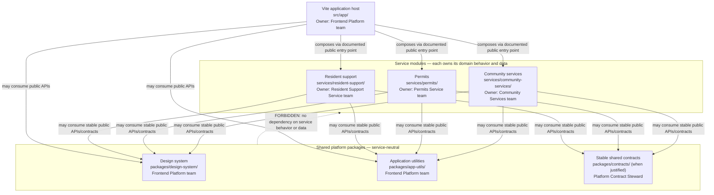

# Workspace boundaries and ownership

## Decision record

- **Status:** Accepted for the initial federated frontend
- **Decision date:** 2026-11-25
- **Scope:** Source-code ownership and dependency direction; this does not
  select a deployment or runtime-federation platform.

### Context

CivicNest starts as one React and TypeScript application built and served by
Vite. The frontend is expected to grow into a platform where teams can own
municipal-service modules and reuse stable platform capabilities. The initial
workspace needs clear ownership and import rules without requiring projects,
build tooling, or deployment infrastructure that do not yet exist.

### Decision

Keep the current Vite application as the host and introduce directories only
when there is real code to put in them. Organize application-owned composition
in `src/app/`, feature-specific UI in `src/features/<feature>/`, reusable
platform libraries in `packages/<package>/`, and independently owned
service modules in `services/<service>/`.

The host composes service modules through their documented public entry points.
Service modules may import public APIs from shared packages, including stable
platform contracts. Shared packages are service-agnostic: they must not import
from `services/`, contain a service's behavior, or define its service-specific
data. Shared contracts are limited to stable concepts that genuinely cross
service boundaries; they are not a place to centralize one service's domain
model. Service-specific business logic, domain models, and synthetic request
schemas or fixtures stay in their owning service module and must never be
added to a shared platform package. A service team proposing a contract change
reviews its compatibility with the platform contract owner before adoption.

These are source and ownership boundaries, not promises of separately
deployable modules. Keep one Vite build and the existing package scripts while
there is one application to build. Do not introduce runtime federation or a
monorepo task orchestrator merely to express ownership. Revisit workspace
orchestration when multiple real packages or applications need coordinated
builds, caching, or affected-project checks. Revisit runtime federation and
independent deployment only if separately released service modules become a
requirement and their operational, security, accessibility, performance, and
contract-versioning costs are understood.

### Dependency and ownership map

The host may also consume shared packages through their public APIs. Each
service consumes only stable shared public APIs or contracts; arrows do not
authorize importing package internals. `packages/contracts/` is an optional,
service-neutral package boundary, not a separate runtime or required initial
project. The dotted reverse arrow is prohibited: shared packages do not
depend on service modules, even for types, test fixtures, or example payloads.

`src/features/` remains the home for capabilities that are part of the current
host application and do not need independent service-team ownership. The
diagram describes the intended dependency direction when the future boundaries
are introduced; it does not claim that empty `packages/` or `services/`
projects already exist.

### Boundary ownership and responsibilities

| Boundary                                                             | Accountable owner role                               | Responsibility                                                                                                                   | Change approval and review                                                                                                                                                                      |
| -------------------------------------------------------------------- | ---------------------------------------------------- | -------------------------------------------------------------------------------------------------------------------------------- | ----------------------------------------------------------------------------------------------------------------------------------------------------------------------------------------------- |
| Application host (`src/app/`)                                        | Frontend Platform team                               | Startup, navigation, configuration, and composition through service public entry points                                          | Frontend Platform team approves host changes; host/service integration changes are reviewed by the affected service owner.                                                                      |
| Host feature (`src/features/<feature>/`)                             | Frontend Platform team, with capability contributors | Host-level UI and behavior without an independent service owner                                                                  | Frontend Platform team approves routine work; changes crossing into an owned service boundary require that service team's review.                                                               |
| Shared design system (`packages/design-system/`, when justified)     | Frontend Platform team                               | Accessible shared tokens, primitives, and generic components; no service workflows, domain rules, or service-owned content       | Frontend Platform team approves routine changes and public API changes; affected package consumers review compatibility-impacting changes.                                                      |
| Shared application utilities (`packages/app-utils/`, when justified) | Frontend Platform team                               | Service-neutral configuration, navigation primitives, error handling, and other genuinely cross-service application capabilities | Frontend Platform team approves routine changes and public API changes; affected consumers review compatibility-impacting changes.                                                              |
| Shared contracts (`packages/contracts/`, when needed)                | Platform Contract Steward                            | Compatibility and review of stable concepts genuinely shared across services                                                     | Contract Steward approves additions and changes after affected service owners review compatibility; breaking changes require explicit approval from affected consumers.                         |
| Resident support (`services/resident-support/`)                      | Resident Support Service team                        | Resident-support discovery and its service-owned assistance/request journey and domain rules                                     | Resident Support Service team approves routine behavior and service API changes; Frontend Platform team reviews host integration, and affected contract consumers review compatibility changes. |
| Permits (`services/permits/`)                                        | Permits Service team                                 | Permit information, eligibility guidance, application workflow, and permit-specific status/domain rules                          | Permits Service team approves routine behavior and service API changes; Frontend Platform team reviews host integration, and affected contract consumers review compatibility changes.          |
| Community services (`services/community-services/`)                  | Community Services team                              | Community-service discovery, categories, filtering, and service-specific presentation/data rules                                 | Community Services team approves routine behavior and service API changes; Frontend Platform team reviews host integration, and affected contract consumers review compatibility changes.       |

The owning role is accountable for routine maintenance and approval; it is
not a named individual. Each package or module publishes its supported entry
point, and consumers import only that API. Shared-package owners may reject a
service-specific behavior or data proposal rather than incorporating it into
the platform.

### Alternatives considered

| Boundary model                                                   | Reuse                                                                                                                                                                                               | Release independence                                                                             | Change risk                                                                                                                         | Operational complexity                                                                                                             |
| ---------------------------------------------------------------- | --------------------------------------------------------------------------------------------------------------------------------------------------------------------------------------------------- | ------------------------------------------------------------------------------------------------ | ----------------------------------------------------------------------------------------------------------------------------------- | ---------------------------------------------------------------------------------------------------------------------------------- |
| One undivided application                                        | Shared code is easy to reach, but unclear ownership encourages either broad coupling or duplicated components; duplicated accessibility fixes can drift.                                            | None; one application is released together.                                                      | Implicit boundaries let service changes leak across the app, while duplicated code can behave inconsistently.                       | Lowest initially: one Vite build and deployment.                                                                                   |
| **Modular source boundaries in one Vite application (selected)** | Reuse stable design-system, utility, and contract APIs; keep service behavior local. Overly broad shared packages increase coordination cost, so promote only genuinely cross-service capabilities. | Modules have clear owners but are released with the host; independent releases are not promised. | Public APIs and owner reviews limit cross-service impact; one build and review-based boundaries do not provide automatic isolation. | Low and implementable now: retain the Vite build and root scripts without federation or an orchestrator.                           |
| Independently deployed federated modules                         | Can share versioned platform APIs, but independently managed integrations may also duplicate capabilities.                                                                                          | Highest: services can ship on separate schedules.                                                | Runtime and version mismatches move risk to integration; failures need explicit ownership and monitoring.                           | Highest: remote loading, deployment coordination, compatibility, security, accessibility, and performance need dedicated controls. |

The selected model prioritizes clear ownership and dependency direction while
avoiding infrastructure that does not yet solve a demonstrated problem. It
trades automatic project-level enforcement and independent deployment for
lower setup cost; those are explicit revisit points, not assumed capabilities.
Compared with the undivided model, it deliberately trades unrestricted reuse
for narrower, reviewable shared APIs: common accessible primitives reduce
accessibility drift, while service-specific logic stays independently owned.
It is the smallest model that makes ownership actionable without claiming
release independence the current stack does not provide.

## Current implementation

The current application remains a single Vite project. `src/main.tsx` is its
entry point; the UI shell and tests live in `src/app/`, shared styling in
`src/styles.css`, and product-specific areas can be grouped under
`src/features/`. The `packages/` and `services/` directories are future
boundaries, not requirements to create placeholder projects.

The TypeScript and lint configuration already includes `src/`, `packages/`,
and `services/`, so the strict checks apply when those directories gain real
modules. The root package scripts remain the common local quality gates.

## Revisit triggers

Review this decision when any of the following becomes true:

- Multiple consumers need the same platform capability or stable contract.
- A service team needs an independently owned module with a public entry
  point.
- Multiple buildable projects need dependency-aware orchestration or
  affected-project checks.
- A service needs independent deployment or release cadence.

Record the concrete consumers, ownership, import graph, compatibility and
deployment requirements, quality/performance measurements, and migration
impact before changing the layout or adding build/runtime infrastructure.

For public entry-point, semantic-versioning, deprecation, and contract-test
expectations, see the [shared package contract policy](./public-contracts.md).

## Verification

- Inspect the diagram: host composition and service-to-shared-package arrows
  are labeled as allowed; the shared-package-to-service dependency is marked
  forbidden.
- Inspect the ownership table: every shared package and service module has an
  accountable role and a change-approval expectation.
- Inspect the alternatives table: each model is compared on reuse, release
  independence, change risk, and operational complexity.
- Confirm the decision rule keeps service-specific behavior and synthetic
  request schemas out of shared packages. Run `pnpm format:check` to verify
  this record follows repository formatting.
