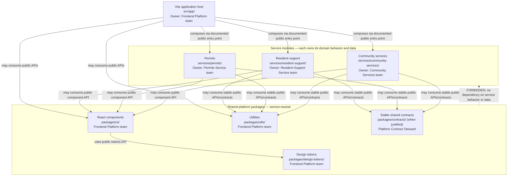

# Workspace boundaries and ownership

## Decision record

- **Status:** Accepted for the initial CivicNest frontend
- **Decision date:** 2026-11-25
- **Scope:** Source-code ownership and dependency direction; this does not
  select a deployment or runtime-federation platform.

### Context

CivicNest is one React and TypeScript application built and served by Vite.
Teams need clear ownership and import rules for municipal-service modules and
reusable platform capabilities without requiring separate build tooling or
deployment infrastructure.

### Decision

Keep the current Vite application as the host. Application-owned composition
lives in `src/app/`, host-only UI in `src/features/<feature>/`, reusable
platform libraries in `packages/<package>/`, and independently owned service
modules in `services/<service>/`. The initial package topology now has
`packages/design-tokens/`, `packages/ui/`, and `packages/utils/`, plus
`services/resident-support/`, `services/permits/`, and
`services/community-services/`.

The host composes service modules through their documented public entry points.
Service modules may import public APIs from shared packages, including stable
platform contracts. Shared packages are service-agnostic: they must not import
from `services/`, contain a service's behavior, or define its service-specific
data. Shared contracts are limited to stable concepts that genuinely cross
service boundaries; they are not a place to centralize one service's domain
model. Service-specific business logic, domain models, and synthetic request
schemas or fixtures stay in their owning service module and must never be
added to a shared platform package. A service team proposing a contract change
reviews its compatibility with the platform contract owner before adoption.
Service modules must not import another service module. Package consumers use
the supported `@civicnest/<package>` roots rather than another package's
internal files.

### Automated dependency boundary check

Run `pnpm boundaries` from the repository root. It parses literal imports,
re-exports, type imports, and literal dynamic imports or `require` calls in
TypeScript and TSX files under `src/`, `packages/`, and `services/`. It rejects
cross-service dependencies, service imports from shared packages, and imports
that reach another owned package or service except through its exact
`@civicnest/<name>` public entry-point alias. The check includes built-in
positive and negative examples for each rule; no intentionally invalid source
files are left in the workspace.

The checker also launches itself against an isolated temporary project and
asserts that a prohibited host-to-service deep import produces a non-zero
status and a diagnostic; the fixture is removed afterward.

The check recognizes service and package aliases using the current
`@civicnest/<directory-name>` convention and also resolves relative paths.
Adding a different alias convention, JavaScript source, generated code, or a
computed non-literal import requires extending the checker; it does not inspect
runtime module loading, external dependency graphs, or whether an import uses
an exported symbol. TypeScript, lint, and build checks remain responsible for
type and module-resolution errors. Run `pnpm check` to include boundary
verification in the normal quality workflow.

#### Boundary verification receipt

Verified on 2026-11-26 from the repository root on
`sprint/month-02-1-7f6b839e`, with Node.js 22.19.0 and pnpm 10.17.1:

| Command           | Result | Evidence                                                                                              |
| ----------------- | ------ | ----------------------------------------------------------------------------------------------------- |
| `pnpm boundaries` | Exit 0 | 18 source files scanned; 20 controlled rule tests and 1 command-level test passed.                    |
| `pnpm check`      | Exit 0 | Lint, boundaries, 5 test files / 8 tests, format check, TypeScript, and Vite production build passed. |

`pnpm check` also passed after adding `.cjs` to the Prettier file patterns, so
the boundary checker source receives the same formatting coverage as the
other JavaScript files.

#### Requesting a boundary exception

The checker has no inline suppression or unreviewed allow-list: an exception
must not be introduced by disabling a rule or adding a one-off path. The
requester records a decision in `docs/` before changing enforcement, including
the exact source and target paths, the rule affected, the concrete need,
alternatives considered, affected owners, compatibility and operational risks,
and a review date. The owner of the source boundary and the owner of the target
boundary must approve it; the Frontend Platform team also approves changes to
the checker and ensures the exception is as narrow as possible.

Record each approval and the review date in the decision. Update the checker
and its positive/negative controlled examples in the same change, then run
`pnpm boundaries` and `pnpm check`. At the recorded date, the source and target
owners and Frontend Platform re-evaluate whether the need remains, confirm the
documented scope still matches the code, and remove the exception if it is no
longer necessary. An exception is not considered approved until its decision
and corresponding tested checker change are reviewed and merged.

These are source and ownership boundaries, not promises of separately
deployable modules. Keep one Vite build and the existing package scripts while
there is one application to build. Do not introduce runtime federation or a
monorepo task orchestrator merely to express ownership. Revisit workspace
orchestration when multiple real packages or applications need coordinated
builds, caching, or affected-project checks. Revisit runtime federation and
independent deployment only if separately released service modules become a
requirement and their operational, security, accessibility, performance, and
contract-versioning costs are understood.

### Dependency and ownership map

The host may also consume shared packages through their public APIs. Each
service consumes only stable shared public APIs or contracts; arrows do not
authorize importing package internals. `packages/contracts/` is an optional,
service-neutral package boundary, not a separate runtime or required initial
project. The dotted reverse arrow is prohibited: shared packages do not
depend on service modules, even for types, test fixtures, or example payloads.

`src/features/` remains the home for capabilities that are part of the current
host application and do not need independent service-team ownership. The
diagram documents the implemented source dependency direction. The directories
are source modules in the existing application; they are not separately
published packages or independently deployed services.

### Boundary ownership and responsibilities

| Boundary                                              | Accountable owner role                               | Responsibility                                                                                                               | Change approval and review                                                                                                                                                                      |
| ----------------------------------------------------- | ---------------------------------------------------- | ---------------------------------------------------------------------------------------------------------------------------- | ----------------------------------------------------------------------------------------------------------------------------------------------------------------------------------------------- |
| Application host (`src/app/`)                         | Frontend Platform team                               | Startup, navigation, configuration, and composition through service public entry points                                      | Frontend Platform team approves host changes; host/service integration changes are reviewed by the affected service owner.                                                                      |
| Host feature (`src/features/<feature>/`)              | Frontend Platform team, with capability contributors | Host-level UI and behavior without an independent service owner                                                              | Frontend Platform team approves routine work; changes crossing into an owned service boundary require that service team's review.                                                               |
| Shared design tokens (`packages/design-tokens/`)      | Frontend Platform team                               | Stable, service-neutral visual tokens consumed through `@civicnest/design-tokens`                                            | Frontend Platform team approves token and API changes; affected consumers review compatibility-impacting changes.                                                                               |
| Shared React components (`packages/ui/`)              | Frontend Platform team                               | Generic accessible components consumed through `@civicnest/ui`; no service workflows, domain rules, or service-owned content | Frontend Platform team approves component and API changes; affected consumers review behavior and compatibility changes.                                                                        |
| Shared utilities (`packages/utils/`)                  | Frontend Platform team                               | Small service-neutral helpers consumed through `@civicnest/utils`; no service-specific business rules                        | Frontend Platform team approves utility and API changes; affected consumers review compatibility-impacting changes.                                                                             |
| Shared contracts (`packages/contracts/`, when needed) | Platform Contract Steward                            | Compatibility and review of stable concepts genuinely shared across services                                                 | Contract Steward approves additions and changes after affected service owners review compatibility; breaking changes require explicit approval from affected consumers.                         |
| Resident support (`services/resident-support/`)       | Resident Support Service team                        | Resident-support discovery and its service-owned assistance/request journey and domain rules                                 | Resident Support Service team approves routine behavior and service API changes; Frontend Platform team reviews host integration, and affected contract consumers review compatibility changes. |
| Permits (`services/permits/`)                         | Permits Service team                                 | Permit information, eligibility guidance, application workflow, and permit-specific status/domain rules                      | Permits Service team approves routine behavior and service API changes; Frontend Platform team reviews host integration, and affected contract consumers review compatibility changes.          |
| Community services (`services/community-services/`)   | Community Services team                              | Community-service discovery, categories, filtering, and service-specific presentation/data rules                             | Community Services team approves routine behavior and service API changes; Frontend Platform team reviews host integration, and affected contract consumers review compatibility changes.       |

The owning role is accountable for routine maintenance and approval; it is
not a named individual. Each package or module publishes its supported entry
point, and consumers import only that API. Shared-package owners may reject a
service-specific behavior or data proposal rather than incorporating it into
the platform.

### Alternatives considered

| Boundary model                                                   | Reuse                                                                                                                                                                                                  | Release independence                                                                             | Change risk                                                                                                                         | Operational complexity                                                                                                             |
| ---------------------------------------------------------------- | ------------------------------------------------------------------------------------------------------------------------------------------------------------------------------------------------------ | ------------------------------------------------------------------------------------------------ | ----------------------------------------------------------------------------------------------------------------------------------- | ---------------------------------------------------------------------------------------------------------------------------------- |
| One undivided application                                        | Shared code is easy to reach, but unclear ownership encourages either broad coupling or duplicated components; duplicated accessibility fixes can drift.                                               | None; one application is released together.                                                      | Implicit boundaries let service changes leak across the app, while duplicated code can behave inconsistently.                       | Lowest initially: one Vite build and deployment.                                                                                   |
| **Modular source boundaries in one Vite application (selected)** | Reuse stable token, component, utility, and contract APIs; keep service behavior local. Overly broad shared packages increase coordination cost, so promote only genuinely cross-service capabilities. | Modules have clear owners but are released with the host; independent releases are not promised. | Public APIs and owner reviews limit cross-service impact; one build and review-based boundaries do not provide automatic isolation. | Low and implementable now: retain the Vite build and root scripts without federation or an orchestrator.                           |
| Independently deployed federated modules                         | Can share versioned platform APIs, but independently managed integrations may also duplicate capabilities.                                                                                             | Highest: services can ship on separate schedules.                                                | Runtime and version mismatches move risk to integration; failures need explicit ownership and monitoring.                           | Highest: remote loading, deployment coordination, compatibility, security, accessibility, and performance need dedicated controls. |

The selected model prioritizes clear ownership and dependency direction while
avoiding infrastructure that does not yet solve a demonstrated problem. It
trades project-level build orchestration and independent deployment for lower
setup cost; those are explicit revisit points, not assumed capabilities. The
automated checker above is source-level enforcement within the current Vite
project; it complements, but does not replace, owner review, and it does not
isolate builds or releases.
Compared with the undivided model, it deliberately trades unrestricted reuse
for narrower, reviewable shared APIs: common accessible primitives reduce
accessibility drift, while service-specific logic stays independently owned.
It is the smallest model that makes ownership actionable without claiming
release independence the current stack does not provide.

## Current implementation

The current application remains a single Vite project. `src/main.tsx` is its
entry point; the UI shell and tests live in `src/app/`, app-level layout in
`src/styles.css`, and host-only features can live under `src/features/`. The
implemented shared package roots are `packages/design-tokens/index.ts`,
`packages/ui/index.tsx`, and `packages/utils/index.ts`. Each representative
service has an `index.tsx` public entry point under `services/`; the host
renders each through its package alias. These are source boundaries in one
build, not independently deployed artifacts.

TypeScript and Vite map the explicit `@civicnest/*` public entry-point aliases
to these files. Consumers use only those aliases; implementation subpaths are
not mapped as supported imports. `packages/ui/` consumes tokens, and each
service module consumes the public token, component, and utility APIs. Shared
packages have no service imports. The root package scripts remain the common
local quality gates. Runtime federation and separate deployment remain
deferred because a single host build is sufficient to prove import boundaries
without the additional remote-loading, compatibility, security, and
operational failure modes.

The cross-package consumption demonstration gives each service local,
typed synthetic fixtures and a focused UI fragment: resident support starts
with guidance available, permits starts in a loading state and can reveal
sample options, and community services starts with an identified sample-request
failure and can recover to example listings. Actions only update local demo
state; they do not call a service or represent real appointment availability.
The Testing Library consumer test imports modules through their public
`@civicnest/*` roots and verifies status, error, and keyboard recovery behavior.

## Revisit triggers

Review this decision when any of the following becomes true:

- Multiple consumers need the same platform capability or stable contract.
- A service team needs an independently owned module with a public entry
  point.
- Multiple buildable projects need dependency-aware orchestration or
  affected-project checks.
- A service needs independent deployment or release cadence and the team can
  operate and verify the resulting runtime boundary.

Record the concrete consumers, ownership, import graph, compatibility and
deployment requirements, quality/performance measurements, and migration
impact before changing the layout or adding build/runtime infrastructure.

For public entry-point, semantic-versioning, deprecation, and contract-test
expectations, see the [shared package contract policy](./public-contracts.md).

## Verification

- Inspect the diagram: host composition and service-to-shared-package arrows
  are labeled as allowed; the shared-package-to-service dependency is marked
  forbidden.
- Inspect the ownership table: every shared package and service module has an
  accountable role and a change-approval expectation.
- Inspect the alternatives table: each model is compared on reuse, release
  independence, change risk, and operational complexity.
- Confirm the decision rule keeps service-specific behavior and synthetic
  request schemas out of shared packages. Run `pnpm format:check` to verify
  this record follows repository formatting.
- Run `pnpm boundaries` to verify the service/shared direction rules and
  their controlled prohibited-import examples.
- Run `pnpm test` and `pnpm build` to verify that all three service consumers
  resolve through their public aliases in the Vite and TypeScript builds.
